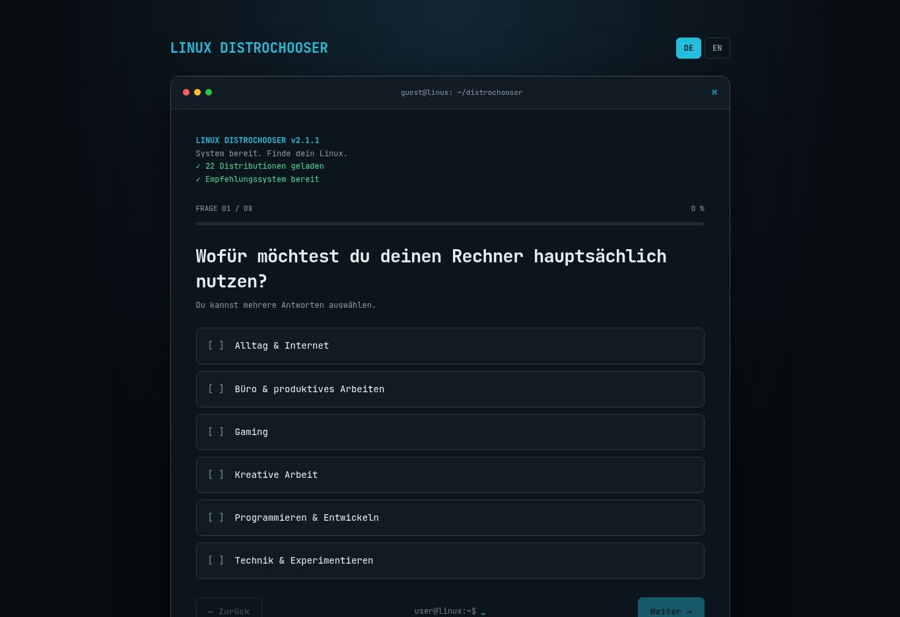
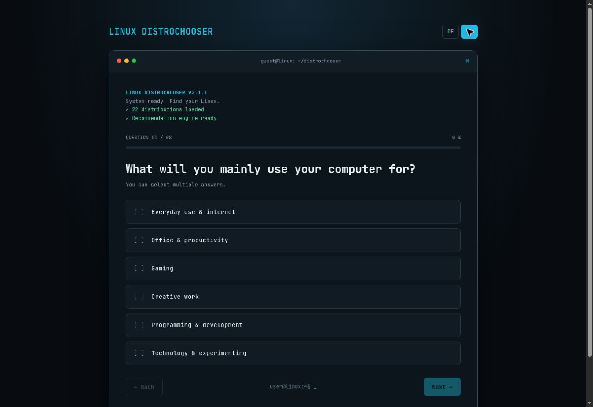

# Linux Distrochooser

**[Deutsch](#deutsch) · [English](#english)**

A bilingual, browser-based Linux distribution recommender. Answer a few questions and discover Linux distributions in the first three score ranks that may suit your hardware, experience, and preferences.

> **Live demo:** https://ff4f-git.github.io/distrochooser/

---

## Deutsch



### Unsere Philosophie: Linux soll einladend sein

**Du musst Linux nicht verstehen, um die richtige Linux-Distribution zu finden.** Genau dabei soll dir der Distrochooser helfen. Wer nach einer Distribution sucht, ist häufig Anfänger, Umsteiger oder einfach unsicher. Statt diesen Menschen mit Fragen zu Init-Systemen, Paketformaten oder anderen Linux-Fachbegriffen abzuschrecken, fragen wir nach ihrem Alltag, ihrer Hardware und ihren Wünschen. Die technische Bewertung gehört in die Punktematrix – nicht als Voraussetzung vor den Fragebogen.

**Keep it simple:** So wenige, so verständliche Fragen wie möglich, aber so differenzierte Empfehlungen wie nötig. Wir bewerten nicht, was sich mit genug Zeit aus jeder Distribution machen *ließe*, sondern wie gut sie sich mit ihren charakteristischen Eigenschaften als Ausgangspunkt für einen Menschen eignet. Profis dürfen mitmachen, sind aber nicht die Zielgruppe, für die wir den Einstieg unnötig kompliziert machen. Unser Ziel ist, Neugier auf Linux zu wecken – nicht sie mit Komplexität zu ersticken.

### Finde ein Linux, das zu dir passt

Linux bietet viele Möglichkeiten – aber welche Distribution passt zu deinem Alltag? **Linux Distrochooser** hilft dir, diese Frage spielerisch und nachvollziehbar zu beantworten. Statt eine beliebige Rangliste anzuzeigen, fragt das Tool nach deinen Anforderungen und vergleicht sie mit einem redaktionell gepflegten Bewertungsmodell.

**Das bietet der Distrochooser:**

- Acht Fragen zu Einsatzzweck, Hardware, Bedienung, Gestaltung, Anpassbarkeit, Wiederherstellung und Linux-Erfahrung.
- Zwei bedingte Zusatzfragen zu Arbeitsspeicher und Grafikkarte.
- Eine redaktionell gepflegte Auswahl von **25 aktiven Distributionen**, einschließlich Solus, Gentoo Linux, TUXEDO OS, Void Linux und antiX.
- Drei Empfehlungen mit kurzen Erläuterungen und relativer visueller Einordnung.
- Umschaltbare Oberfläche auf **Deutsch und Englisch**, auch während des Fragebogens.
- Eine transparente Punktematrix und eine dokumentierte Bewertungslogik.
- Freiwillige Ergebnisstatistik nach dem Test mit öffentlicher Top-3-Rangliste.

### Wie entstehen die Empfehlungen?

Jede Antwort ist mit Gewichtungen für die berücksichtigten Distributionen verknüpft. Der Distrochooser addiert diese Werte und berücksichtigt bei Gaming gegebenenfalls die Grafikkarte. Anschließend werden alle Ergebnisse der ersten drei Rangstufen angezeigt. Die Balken dienen der **relativen Darstellung**, nicht als objektive Qualitäts- oder Kompatibilitätsprozente.

Die Gewichtungen sind bewusst redaktionelle Einschätzungen. Sie können sich mit der Entwicklung von Distributionen ändern und ersetzen keine eigene Recherche, insbesondere bei Treibern, Hardware-Kompatibilität und Spielen mit Anti-Cheat.

**Freiwillige Statistik:** Beiträge werden ausschließlich nach ausdrücklichem Klick auf „Ergebnis zur Statistik beitragen“ übertragen. Nach erfolgreichem Beitrag erscheint ein zusätzlicher Link „Öffentliche Statistik ansehen“ im Ergebnisbereich; der Footer-Link ist immer sichtbar. Die [öffentliche Statistik](statistik.html) zeigt ab dem ersten Beitrag die Gesamtzahl und maximal drei Distributionen, sortiert nach Häufigkeit ihrer **Erstplatzierung** (bei Gleichstand alphabetisch). Es handelt sich um Empfehlungen des Modells, nicht um Nutzerstimmen für eine Distribution. Die Statistik umfasst etwa 90 Tage und ist nicht repräsentativ. [Installation und Einrichtung (DE/EN)](docs/statistics-setup.md).

Mehr dazu: [Konzept](docs/konzept.md) · [Bewertungslogik](docs/bewertungslogik.md) · [JSON-Punktematrix](data/distributions.json)

---

## English



### Our philosophy: Make Linux welcoming

**You shouldn't need to understand Linux to find the right Linux distribution.** That's what this chooser is here for. People looking for a distribution are often beginners, switchers, or simply unsure where to start. Rather than confronting them with questions about init systems, package formats, or other Linux jargon, we ask about everyday use, hardware, and preferences. The technical reasoning belongs in the scoring matrix—not as a prerequisite for taking the questionnaire.

**Keep it simple:** As few clear questions as possible, with as much differentiation as necessary. We don't score everything a distribution *could* become with enough effort; we score how suitable its characteristic defaults and design principles make it as a starting point for a particular person. Experienced users are welcome, but they aren't the audience we should make the entry point harder for. Our aim is to encourage curiosity about Linux, not overwhelm it with complexity.

### Find a Linux distribution that fits you

Linux offers a wealth of choices, but where should you start? **Linux Distrochooser** is an interactive questionnaire that helps you explore distributions based on your needs, rather than presenting a generic popularity ranking.

**Features:**

- Eight questions covering usage, hardware, ease of use, appearance, customization, recovery options, and Linux experience.
- Two conditional follow-up questions about RAM and graphics hardware.
- An editorially maintained catalog of **25 active distributions**, including Solus, Gentoo Linux, TUXEDO OS, Void Linux, and antiX.
- Three recommendations with brief explanations and relative visual comparisons.
- A **German/English** language switch that works throughout the questionnaire.
- An inspectable scoring matrix and documentation of the recommendation model.
- Optional post-result statistics contribution with a public top-three ranking.

### How does it work?

Each answer contributes weighted points to the included distributions. Gaming-related answers may also include a graphics-hardware adjustment. All distributions in the first three distinct score ranks are then shown. The visual bars express **relative scores**, not objective quality or compatibility percentages.

Weights reflect editorial judgment and may change as distributions evolve. Always verify hardware, driver, and game compatibility independently, especially for multiplayer games with anti-cheat systems.

**Optional statistics:** Only an explicit click submits a result. After a successful contribution, a “View public statistics” link appears in the results; the footer link remains available to everyone. The [public dashboard](statistik.html) displays the total and up to three most frequent **first-choice recommendations** starting with the first contribution (alphabetical tie-break). These are model recommendations, not votes for a distribution. Figures cover approximately 90 days and are not representative. [Operations guide](docs/statistics-setup.md).

For a closer look, see the [concept](docs/konzept.md), [scoring logic](docs/bewertungslogik.md) and [JSON scoring matrix](data/distributions.json).

---

## Project structure / Projektstruktur

```text
index.html                  Web application / Webanwendung
assets/app.js               Questionnaire, language switch, scoring, results
assets/styles.css           Visual design / Gestaltung
assets/icons.js             Distribution icon mappings
data/distributions.json     Versioned catalog / versionierter Distributionskatalog
assets/model.json           Distribution points and German questions
assets/gpu-bonus.json       Gaming GPU adjustments
assets/questions-en.json    English questions and answer labels
assets/descriptions-de.json German result descriptions
assets/descriptions-en.json English result descriptions
assets/statistics-config.js  Active public statistics endpoint
supabase/migrations/         Private storage and public aggregation SQL migrations
supabase/functions/          Server-side submission handler / Serverfunktion
docs/statistics-setup.md     Supabase setup (statistics + catalog) / Einrichtung DE/EN
supabase/functions/catalog-admin/ Versioned catalog API and publishing / Katalogverwaltung
supabase/functions/submit-statistics/ Optional statistics / freiwillige Statistik
statistik.html                Public statistics dashboard / Öffentliche Statistik
datenschutz.html             Privacy notice / Datenschutzhinweise
docs/                       Short concept, scoring, administration and setup guides / Dokumentation
```

**Technology / Technik:** Vanilla HTML, CSS, and JavaScript modules. No framework or user account required for the questionnaire. Recommendations are calculated in the browser using the current versioned catalog served by Supabase, with `data/distributions.json` as the static fallback. Supabase also provides the protected catalog publishing service and optional statistics; only an explicit opt-in submits questionnaire statistics.

**License / Lizenz:** No open-source license has been granted yet. All rights reserved until a license is explicitly added.


<!-- Result ranking rule, 2026-11-01 -->
### Ergebnisränge bei Punktgleichstand

Die ersten drei unterschiedlichen Punktwerte bilden Platz 1, 2 und 3. Alle punktgleichen Distributionen teilen sich denselben Platz; kein Rang wird übersprungen. Beispiel: 90, 90, 80, 70 ergibt 1, 1, 2, 3. Deshalb können mehr als drei Empfehlungen erscheinen. Die Punkte selbst werden durch einen Gleichstand nicht verändert.


## Supabase installation / Supabase-Einrichtung

**DE:** Bei einer neuen Installation alle fünf SQL-Migrationen in Reihenfolge ausführen, beide Edge Functions (`submit-statistics`, `catalog-admin`) bereitstellen und den aktuellen Katalog als erste Veröffentlichung in Supabase registrieren. Für reine Punkteänderungen ist danach kein erneutes Deployment nötig. [Vollständige Anleitung](docs/statistics-setup.md) · [Katalogverwaltung](docs/administration.md).

**EN:** On a fresh installation, apply all five SQL migrations in order, deploy both Edge Functions (`submit-statistics` and `catalog-admin`), and register the initial versioned catalog in Supabase. Subsequent scoring changes do not require function redeployment. [Step-by-step installation guide](docs/statistics-setup.md) · [Catalog administration](docs/administration.md).

## Administration

Distributionen, Beschreibungen und sämtliche Bewertungen werden über [die Distributionsverwaltung](https://ff4f-git.github.io/distrochooser/admin.html) gepflegt. Ein Speichervorgang veröffentlicht die geprüfte Version für Website und Statistik und erzeugt die benötigten JSON-Dateien. [Zugang und Betrieb](docs/administration.md).
