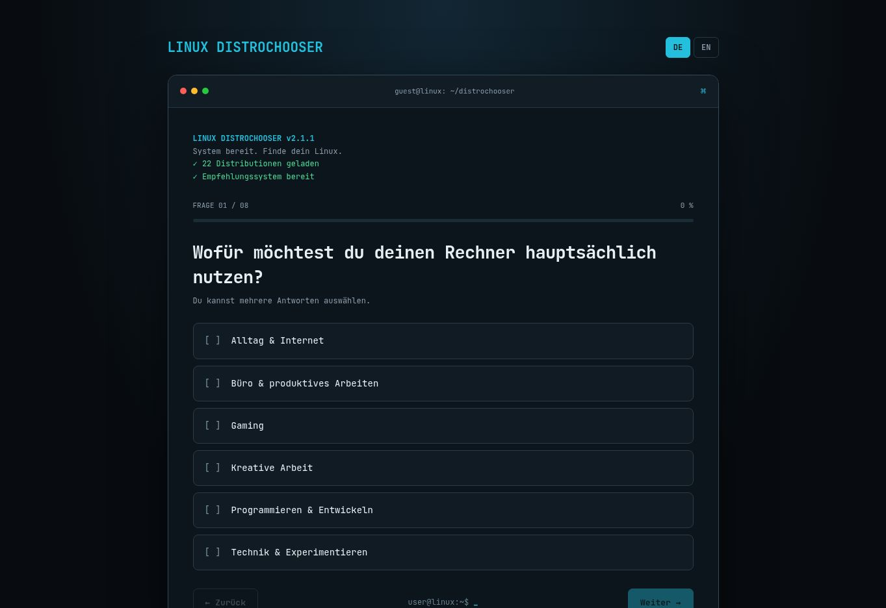
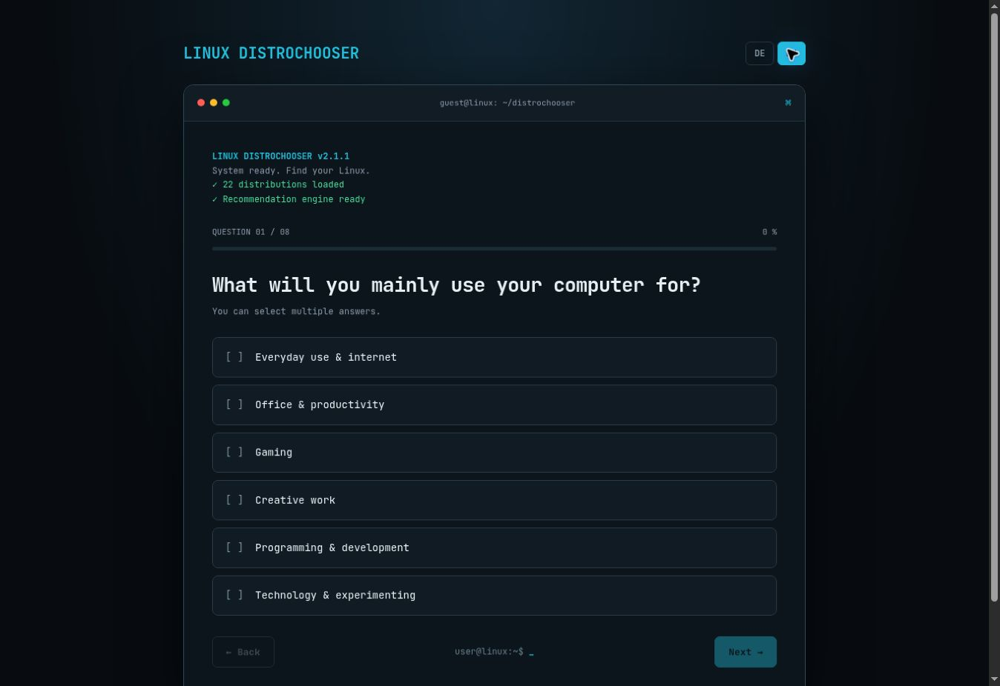

# Linux Distrochooser

**[Deutsch](#deutsch) · [English](#english)**

A bilingual, browser-based Linux distribution recommender. Answer a few questions and discover three Linux distributions that may suit your hardware, experience, and preferences.

> **Live demo:** https://ff4f-git.github.io/distrochooser/

---

## Deutsch



### Finde ein Linux, das zu dir passt

Linux bietet viele Möglichkeiten – aber welche Distribution passt zu deinem Alltag? **Linux Distrochooser** hilft dir, diese Frage spielerisch und nachvollziehbar zu beantworten. Statt eine beliebige Rangliste anzuzeigen, fragt das Tool nach deinen Anforderungen und vergleicht sie mit einem redaktionell gepflegten Bewertungsmodell.

**Das bietet der Distrochooser:**

- Acht Fragen zu Einsatzzweck, Hardware, Bedienung, Gestaltung, Anpassbarkeit, Wiederherstellung und Linux-Erfahrung.
- Zwei bedingte Zusatzfragen zu Arbeitsspeicher und Grafikkarte.
- Eine Auswahl aus **22 Distributionsvarianten**.
- Drei Empfehlungen mit kurzen Erläuterungen und relativer visueller Einordnung.
- Umschaltbare Oberfläche auf **Deutsch und Englisch**, auch während des Fragebogens.
- Eine transparente Punktematrix und eine dokumentierte Bewertungslogik.
- Freiwillige Ergebnisstatistik nach dem Test (derzeit noch nicht für Besucher aktiviert).

### Wie entstehen die Empfehlungen?

Jede Antwort ist mit Gewichtungen für die berücksichtigten Distributionen verknüpft. Der Distrochooser addiert diese Werte und berücksichtigt bei Gaming gegebenenfalls die Grafikkarte. Anschließend werden die drei höchsten Ergebnisse angezeigt. Die Balken dienen der **relativen Darstellung**, nicht als objektive Qualitäts- oder Kompatibilitätsprozente.

Die Gewichtungen sind bewusst redaktionelle Einschätzungen. Sie können sich mit der Entwicklung von Distributionen ändern und ersetzen keine eigene Recherche, insbesondere bei Treibern, Hardware-Kompatibilität und Spielen mit Anti-Cheat.

**Freiwillige Statistik (Einrichtungsstand 27.10.2026):** Die Supabase-Datenbankmigration wurde ausgeführt und die Edge Function `submit-statistics` erfolgreich bereitgestellt. Live-Tests, Datenschutzprüfung und Freischaltung der öffentlichen URL stehen noch aus. Antworten werden nicht automatisch gesendet. [Einrichtung und Prüfung (DE/EN)](docs/statistics-setup.md).

Mehr dazu: [Konzept](docs/konzept.md) · [Bewertungslogik](docs/bewertungslogik.md) · [Punktematrix](data/punktematrix.xlsx)

---

## English



### Find a Linux distribution that fits you

Linux offers a wealth of choices, but where should you start? **Linux Distrochooser** is an interactive questionnaire that helps you explore distributions based on your needs, rather than presenting a generic popularity ranking.

**Features:**

- Eight questions covering usage, hardware, ease of use, appearance, customization, recovery options, and Linux experience.
- Two conditional follow-up questions about RAM and graphics hardware.
- **22 distribution variants** to compare.
- Three recommendations with brief explanations and relative visual comparisons.
- A **German/English** language switch that works throughout the questionnaire.
- An inspectable scoring matrix and documentation of the recommendation model.
- Optional post-result statistics contribution (not yet enabled for visitors).

### How does it work?

Each answer contributes weighted points to the included distributions. Gaming-related answers may also include a graphics-hardware adjustment. The three highest-scoring distributions are then shown. The visual bars express **relative scores**, not objective quality or compatibility percentages.

Weights reflect editorial judgment and may change as distributions evolve. Always verify hardware, driver, and game compatibility independently, especially for multiplayer games with anti-cheat systems.

**Optional statistics (setup status as of 27 October 2026):** The Supabase database migration has been applied and the `submit-statistics` Edge Function deployed. Live testing, privacy review and publishing the endpoint configuration are still pending. Answers are never sent automatically. [Bilingual setup and verification guide](docs/statistics-setup.md).

For a closer look, see the [concept](docs/concept.md), [scoring documentation](docs/scoring-logic.md), and [scoring matrix](data/punktematrix.xlsx).

---

## Project structure / Projektstruktur

```text
index.html                  Web application / Webanwendung
assets/app.js               Questionnaire, language switch, scoring, results
assets/styles.css           Visual design / Gestaltung
assets/icons.js             Distribution icon mappings
data/punktematrix.xlsx      Source scoring matrix / Punktematrix
assets/model.json           Distribution points and German questions
assets/gpu-bonus.json       Gaming GPU adjustments
assets/questions-en.json    English questions and answer labels
assets/descriptions-de.json German result descriptions
assets/descriptions-en.json English result descriptions
assets/statistics-config.js  Optional statistics endpoint (empty until enabled)
supabase/migrations/         Private database migration / Datenbankmigration
supabase/functions/          Server-side submission handler / Serverfunktion
docs/statistics-setup.md     Bilingual setup and operations / Anleitung DE/EN
docs/                       Concept and scoring notes / Dokumentation
```

**Technology / Technik:** Vanilla HTML, CSS, and JavaScript modules. No framework or user account required for the questionnaire. Recommendations run entirely in the browser using local JSON assets loaded through HTTP(S). The optional statistics feature uses a separate Supabase database and Edge Function only when explicitly enabled and submitted by a visitor.

**License / Lizenz:** No open-source license has been granted yet. All rights reserved until a license is explicitly added.
